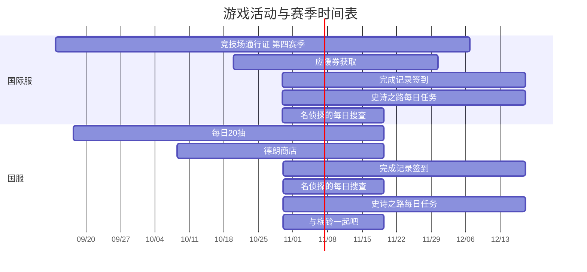

时间表由共享游戏资料生成，时间均为北京时间。两服共用日期按服展示，过渡期差异单独保留；手动推算的依据见共享资料的来源说明。
正式开放时刻未知的活动，以首次确认开放时刻作为资料起点，详见来源。旧资料的国服自动顺延仍会单独标注。

更新时点：2026-10-29 22:26。主图只显示尚未结束的已知时段；已结束时段保存在下方历史记录。

| 项目 | 服务器 | 起点 | 结束 | 状态 | 日期依据 |
| --- | --- | --- | --- | --- | --- |
| 竞技场通行证 第四赛季 | 国际服 | 2026-09-13 20:00 | 2026-12-06 20:00 | 进行中 | 已填写；依据见资料来源 |
| 每日20抽 | 国服 | 2026-09-17 11:00 | 2026-11-19 11:00 | 进行中 | 已填写；依据见资料来源 |
| 与梅铃一起吧！ | 国服 | 2026-10-29 22:26 | 2026-11-19 11:00 | 进行中 | 已填写；依据见资料来源 |
| 应援券获取 | 国际服 | 2026-10-19 21:10 | 2026-11-30 11:00 | 进行中 | 已填写；依据见资料来源 |
| 完成记录签到 | 国际服 | 2026-10-29 20:37 | 2026-12-18 02:00 | 进行中 | 已填写；依据见资料来源 |
| 完成记录签到 | 国服 | 2026-10-29 22:26 | 2026-12-18 03:00 | 进行中 | 已填写；依据见资料来源 |
| 名侦探的每日搜查 | 国际服 | 2026-10-29 20:39 | 2026-11-19 11:00 | 进行中 | 已填写；依据见资料来源 |
| 名侦探的每日搜查 | 国服 | 2026-10-29 22:26 | 2026-11-19 11:00 | 进行中 | 已填写；依据见资料来源 |
| 史诗之路每日任务 | 国际服 | 2026-10-29 20:37 | 2026-12-18 02:00 | 进行中 | 已填写；依据见资料来源 |
| 史诗之路每日任务 | 国服 | 2026-10-29 22:26 | 2026-12-18 03:00 | 进行中 | 已填写；依据见资料来源 |
| 德朗商店 | 国服 | 2026-10-08 11:00 | 2026-11-19 11:00 | 进行中 | 已填写；依据见资料来源 |

国际服暗影情报委托、国服竞技场通行证、国服暗影情报委托：当前期日期尚未确认，未自动续期；任务沿用默认规则。

已结束活动与赛季（历史记录）

| 项目 | 服务器 | 起点 | 结束 | 状态 | 日期依据 |
| --- | --- | --- | --- | --- | --- |
| 竞技场通行证 第三赛季 | 国服 | 2026-07-12 20:00 | 2026-10-04 20:00 | 已结束 | 已填写；依据见资料来源 |
| 暗影情报委托 | 国际服 | 2026-09-17 11:00 | 2026-10-08 11:00 | 已结束 | 已填写；依据见资料来源 |
| 暗影情报委托 | 国服 | 2026-09-17 11:00 | 2026-10-08 11:00 | 已结束 | 已填写；依据见资料来源 |
| 每日20抽 | 国际服 | 2026-08-27 02:00 | 2026-10-29 02:00 | 已结束 | 已填写；依据见资料来源 |
| E7WC 激战门扉 | 国际服 | 2026-09-10 11:00 | 2026-09-27 11:00 | 已结束 | 已填写；依据见资料来源 |
| 与小春收集抽奖券 | 国际服 | 2026-09-17 11:00 | 2026-10-08 11:00 | 已结束 | 已填写；依据见资料来源 |
| 与梅铃一起吧！ | 国际服 | 2026-10-08 11:00 | 2026-10-29 11:00 | 已结束 | 已填写；依据见资料来源 |
| 德朗商店 | 国际服 | 2026-09-17 11:00 | 2026-10-29 11:00 | 已结束 | 已填写；依据见资料来源 |

尚未填写日期的类别只提供默认规则，不显示为已确认赛季。
